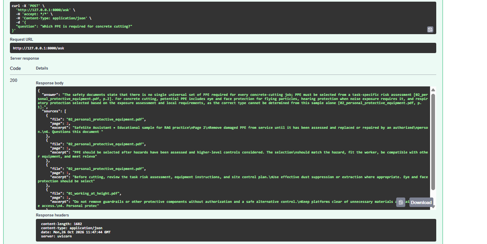
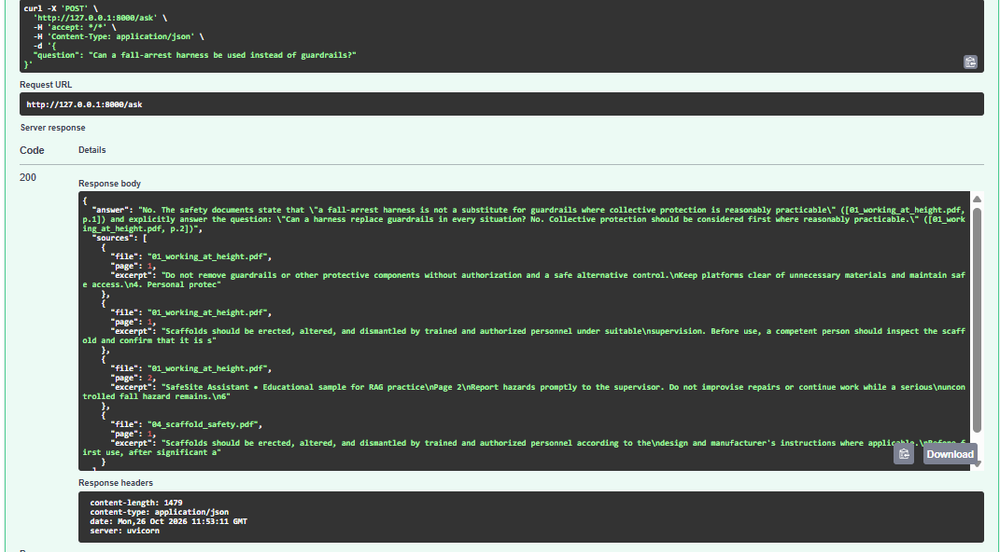
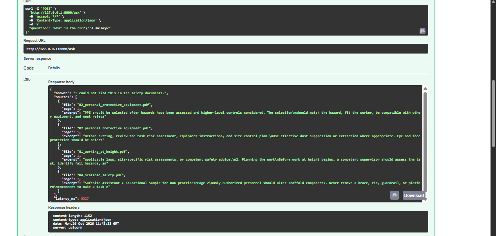

# SafeSite Assistant

A RAG chatbot that answers construction-site safety questions **only from the provided documents** and always shows where each answer comes from.

Stack: LangChain (LCEL), OpenRouter free LLM, local HuggingFace embeddings (all-MiniLM-L6-v2), Chroma (persisted on disk), FastAPI.

## Setup


python -m venv .venv && .venv\Scripts\activate
pip install -r requirements.txt
copy .env.example .env     
python ingest.py
uvicorn api:app --reload


Then open http://127.0.0.1:8000/docs and call `POST /ask` with `{"question": "Which PPE is required for concrete cutting?"}`.

## Architecture

```
data/*.pdf
   |
   v
ingest.py: load (PyMuPDF) -> split (RecursiveCharacterTextSplitter) -> embed (MiniLM) -> Chroma (vectorstore/)
                                                                                           |
question --> api.py (POST /ask) --> retriever (top-k = 4) --> prompt --> LLM (OpenRouter free) --> answer + sources
                                                                          |
                                                                          +--> fallback free model on 429 / timeout
```

## Project structure

- `ingest.py`: builds the vector store (re-running adds no duplicates)
- `retriever.py`: loads the store and returns the retriever
- `rag_chain.py`: prompt + LCEL chain + `ask()` function
- `api.py`: FastAPI endpoint
- `eval/`: evaluation questions, runner and results 

## Design choices

**Chunking (800 characters, 120 overlap).** The documents are short training texts made of small paragraphs, each holding one rule. 800 characters (about 120 to 150 words) is roughly one rule with its context, small enough to keep retrieval precise. The 120-character overlap (about 15%) stops a rule from being cut away from its condition at a chunk boundary. Chunks under 60 characters (page-number or header fragments) are dropped. Each chunk keeps its `source` file and 1-based `page` for citations.

**No duplicates on re-run.** Each chunk gets a deterministic ID (SHA-1 of file, page and text). `ingest.py` only adds chunks whose ID is not already in the store, so a second run adds 0 chunks.

**Embeddings.** `all-MiniLM-L6-v2` runs locally for free, with normalized vectors. The vector store is Chroma, persisted in `vectorstore/`.

**Retrieval: similarity vs MMR (k = 4).** I compared both on three questions (scaffold guardrail height, 24 hours after an incident, PPE for concrete cutting). Plain similarity returned the most relevant chunk each time. MMR removed one near-duplicate chunk, but on a corpus of only 31 chunks it also replaced relevant chunks with off-topic ones (for example a scaffold guardrail chunk for the concrete-cutting question). I therefore use similarity search. MMR would likely help more on a larger corpus with many redundant passages.

**Prompt.** The prompt tells the model to answer only from the context, to cite sources as `[file, p.X]` (each chunk is shown to the model with its label), and to reply exactly "I could not find this in the safety documents." when the context is insufficient. The temperature is 0.

**Robustness.** Each model call has a 60 s timeout and 2 automatic retries (covering HTTP 429 and timeouts). If the main free model still fails, `.with_fallbacks()` sends the request to a second free model. If both fail, the API returns a clear JSON error (429, 504 or 502) instead of crashing.
## Evaluation

10 questions in `eval/questions.json` (8 answerable, 2 not in the documents), run with `python eval/run_eval.py`. Full answers are saved in `eval/results.json`.

| Metric | Result |
|---|---|
| Accuracy on answerable questions | 7/8 fully correct, 1 partially correct |
| Correct refusals | 2/2 |
| Average latency | about 17 s (min 4.9 s, max 42 s) |

Accuracy was checked by hand against the source PDFs. The only partial answer is the "first 24 hours after an incident" question: the model correctly said the documents set no universal 24-hour rule, but left out "notify the supervisor as soon as practicable" and the legal-deadline point.

## Limits

- **Incomplete answers:** the prompt asks for answers from the context, not for completeness, so some answers stop early (see the partial answer above).
- **Citation precision:** one answer cited the page next to the one that contains the sentence (p.2 instead of p.1).
- **Sources on refusals:** the API always returns the 4 retrieved chunks, even when the answer is the refusal sentence.
- **Latency:** free models are slow and variable (5 to 42 s), and they can be rate-limited.
- **Small test set:** 10 questions and a 31-chunk corpus give only a rough picture.

## Next improvements

- Add a prompt line asking for all relevant points, then re-run the evaluation.
- Return no sources when the answer is a refusal.
- Add conversational memory for follow-up questions, answer streaming, and a Streamlit chat UI.
- Try hybrid search (BM25 + vectors) and re-ranking on a larger document set.
- Add a Docker setup.
## Demo

Screenshots of 3 questions answered with sources (the third one is correctly refused):



